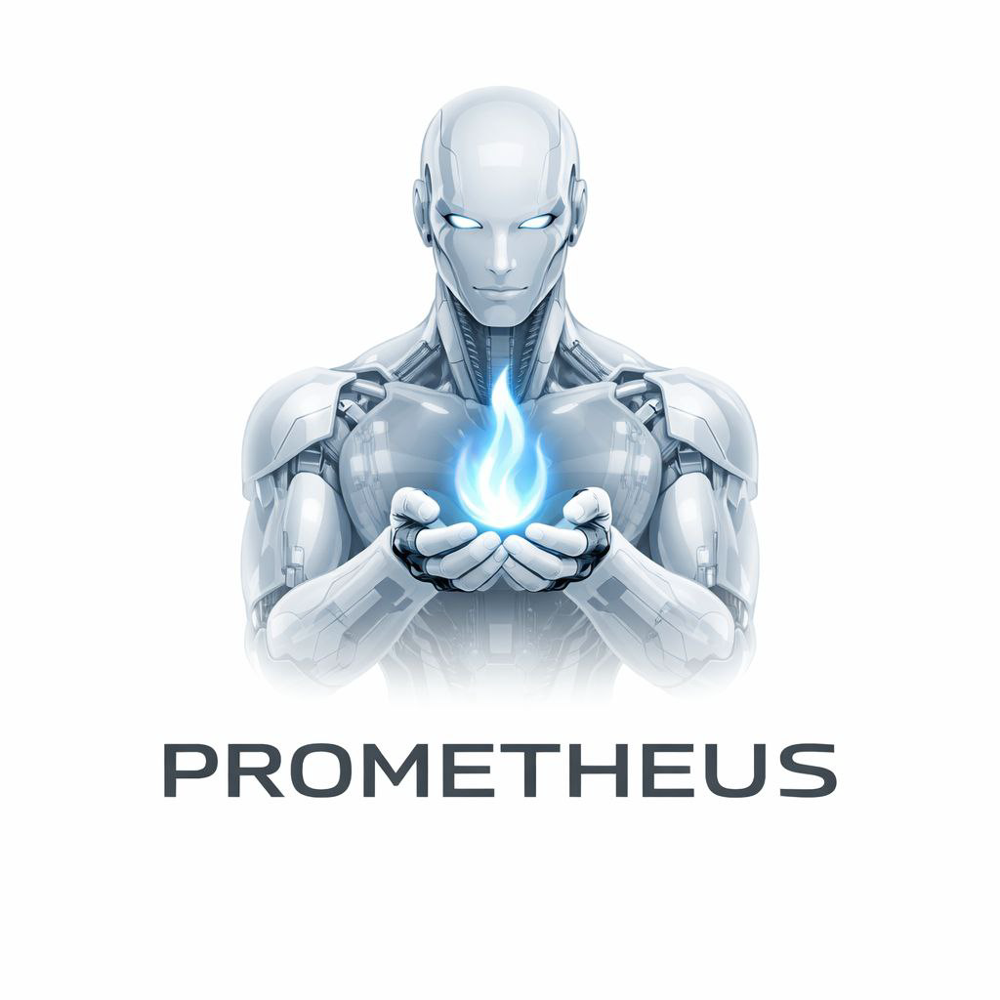

# aufusiding-AI

<p align="center">
  
</p>

**A local-first AI assistant in Rust · Early Alpha**

[简体中文](README.md) · English · [日本語](README.ja.md) · [Français](README.fr.md)

[](https://github.com/zuixi01/aufusiding-AI/actions/workflows/ci.yml)
[](LICENSE)

aufusiding-AI explores local conversations, persistent sessions and model routing. Internal crates, binaries, application names and configuration directories retain the **Prometheus AI** name; the CLI binary is `prometheus`.

This is an early alpha for developers. Start with the CLI and Ollama. HTTP, desktop, mobile, voice and IoT integrations have different levels of completeness; some paths use simulated data or require additional integration. APIs and data formats may change. The project does not claim production readiness, regulatory compliance, measured savings or verified support for every platform. See [feature status and limitations](docs/project-status.md) (Chinese).

## Quick start: local CLI

Install Git, rustup (the repository pins Rust **1.99.1**), native C/C++ build tools, and [Ollama](https://ollama.com/). The CLI does not require Node.js, Bun or Docker. The pinned toolchain is the current development baseline, not an established minimum supported Rust version.

Start the Ollama application or run `ollama serve` in a separate terminal, then:

```bash
git clone https://github.com/zuixi01/aufusiding-AI.git
cd aufusiding-AI
ollama pull qwen2.5:1.5b
ollama list
cargo run --locked -p prometheus-cli -- --help
cargo run --locked -p prometheus-cli -- ask "Hello, introduce yourself in one sentence." --model qwen2.5:1.5b
cargo run --locked -p prometheus-cli -- chat
```

In the REPL, use `/switch qwen2.5:1.5b` to select an installed model, `/help` for commands and `/quit` to exit. The default Ollama endpoint is `http://localhost:11434`; set `PROMETHEUS_PROVIDER_OLLAMA_URL` to override it. Model weights are not included, and hardware requirements depend on your model.

To try the CLI without a model, explicitly select offline simulation:

```bash
cargo run --locked -p prometheus-cli -- --mock ask "Hello"
```

Mock replies are simulated. `model list` uses a static catalog and `model test` is a placeholder; use `ollama list` to check installed models.

## Configuration and development

```bash
cargo run --locked -p prometheus-cli -- config list
cargo run --locked -p prometheus-cli -- config set default_model qwen2.5:1.5b
cargo run --locked -p prometheus-cli -- session list
cargo fmt --all -- --check
cargo check --locked -p prometheus-cli
cargo test --locked -p prometheus-cli
```

`config list` prints the configuration file and local data directory. Sessions and REPL history are stored locally; review exports and logs before sharing them. Not every stored setting is wired into inference yet. See the [setup and configuration guide](docs/getting-started.md) for exact limits, local HTTP examples and troubleshooting.

The Rust engine is in `core/`, CLI in `cli/`, HTTP service in `server/`, clients in `apps/`, bindings in `ffi/` and plugin examples in `plugins/`. Desktop and mobile clients are experimental and need their platform toolchains; source availability does not establish end-to-end support.

## Documentation and contribution

- [Setup, configuration and troubleshooting](docs/getting-started.md) (Chinese)
- [Feature status and known limitations](docs/project-status.md) (Chinese)
- [Architecture](docs/architecture.md) · [API reference](docs/api-reference.md)
- [Contribution guide](CONTRIBUTING.md) · [Code of conduct](CODE_OF_CONDUCT.md)
- [Security policy](SECURITY.md) · [Report an issue](https://github.com/zuixi01/aufusiding-AI/issues/new/choose)

Please include reproduction steps, platform details and the checks you actually ran. Design documents and historical plans may describe features that are not connected to every entry point.

Code is licensed under the [MIT License](LICENSE). External models, services, datasets and dependencies have their own terms.
